# AITRADER: Can simple rules, ML, or rotation beat buy-and-hold?

A research framework for testing stock-trading ideas honestly. It was inspired by a viral claim that an
AI-written bot turned $68 into $750K. Instead of taking that on faith, this project builds the tooling to
test such claims: realistic backtests, out-of-sample validation, and a **luck test** that measures how good
a strategy looks on data with no real patterns in it.

**Headline finding:** across rule-based strategies, walk-forward tuning, machine learning, volatility
targeting, ETF momentum rotation, and pooled-stock selection with ridge, gradient boosting and small neural
nets, nothing reliably beat buy-and-hold on return. The only consistent benefit was **smaller drawdowns** from
risk control (volatility targeting, trend filters, diversification). Even the risk-adjusted benefit was concentrated
in US equities and did not pass a strict luck test across asset classes.

> Research project, not financial advice. Everything here uses historical data or Alpaca **paper**
> trading (fake money). The code has no live-trading mode.

## What's in the box

| Module | Purpose |
|---|---|
| `aitrader/data.py` | Alpaca bars (free IEX feed, ~5 years) and Yahoo Finance history (decades), cached on disk; synthetic data for tests |
| `aitrader/strategy.py` | Strategy interface plus SMA crossover, 200-day trend filter, volatility targeting, RSI dip-buying, breakout |
| `aitrader/ml_strategy.py` | Walk-forward ML: logistic regression, random forest, gradient boosting; configurable horizon, retrain schedule, training window |
| `aitrader/backtest.py` | Long/flat backtester: one-bar execution delay, transaction costs, metrics vs buy-and-hold over the same window |
| `aitrader/walkforward.py` | Self-tuning parameters on a rolling window, scored out-of-sample only |
| `aitrader/compare.py` | Every strategy x many tickers over an identical window |
| `aitrader/sweep.py` | Mass search (336 variations) with search / validation / holdout split and a bootstrap luck test; resumable |
| `aitrader/rotation.py` | Monthly ETF momentum rotation (23 ETFs) with an optional dual-momentum cash filter |
| `aitrader/crosssec.py` | Pooled-stock selection: 154 stocks, 8 ranked features, walk-forward momentum / ridge / gradient boosting / neural net, beta-hedged evaluation |
| `aitrader/minervini.py` | Minervini-style trend-template stock portfolio (5 fixed variants), SPY-filter baseline, RSP survivorship check, luck test |
| `aitrader/riskstudy.py` | Volatility targeting, trend and risk parity across 17 ETFs with T-bill cash, leverage costs and a bootstrap luck test |
| `aitrader/volforecast.py` | Nine volatility forecasters (EWMA, GARCH, HAR, gradient boosting, neural net) scored on accuracy and on strategy impact |
| `aitrader/regime.py` | Markov-switching regime model (walk-forward) as an overlay on buy and hold, with a random-timing luck test and drawdown/duration diagnostics |
| `aitrader/globalstudy.py` | The frozen volatility rule and 200-day trend rule on 19 markets (S&P 500 since 1960, 9 countries, 9 other assets) with paired and pattern-free bootstrap tests |
| `aitrader/stockstudy.py` | Individual big stocks vs SPY: rolling-window win rates, random baskets, and the largest companies at past dates with bounds for missing data |
| `aitrader/govstakes.py` | Sourced list of reported US government equity stakes (confidence and sources per deal) and how the listed stocks did since each announcement vs SPY |
| `aitrader/gap.py` | Cross-market gap test (SPY vs IVV): are apparent price gaps profitable after bid/ask spread, fees and latency? |
| `aitrader/paper.py` | One-shot paper trader against Alpaca's paper account, with a CSV decision log |
| `tests/` | Lookahead checks for every strategy, cost and walk-forward behavior, gap detector |

## Method (why the numbers can be trusted more than most backtests)

- **No lookahead.** A signal at bar *t* trades at bar *t+1*. A test changes only future prices and asserts
  that past signals are unchanged, for every strategy including the ML ones.
- **Costs included.** Turnover is charged per trade (1 bp for stocks and ETFs, 5 bps for rotation).
- **Same window for everyone.** Strategies and the buy-and-hold benchmark are scored over identical bars.
  (An early version compared ML against a longer period; fixing that changed how the results read.)
- **Walk-forward ML.** Models only train on labels already known at each bar, and are retrained periodically.
- **Search, validation, holdout.** Finalists are chosen on the earliest 50% (search), then the next 25%
  (validation). The last 25% is looked at once, for finalists only.
- **Luck test.** The identical search is rerun on block-bootstrapped prices (whole days resampled in
  10-day blocks, jointly across tickers so correlations survive). That destroys real patterns while keeping the
  same return distribution. The real result only counts if it beats what searching fake data produces.

## Results

### 1. Five years of data (Alpaca, 2020-2026, a mostly bull market)
- SPY, SMA 20/50: +48.7% vs +213.6% for buy-and-hold. Sharpe 0.61 vs 1.06.
- Across 10 tickers (same window), **no strategy beat buy-and-hold on return**; volatility targeting cut the
  worst drawdown on 10 of 10.

### 2. 336-variation sweep with luck test (Alpaca data, 10 tickers)
- Only 4 of 336 variations beat buy-and-hold in the search window; the best scored a Sharpe of 0.97 vs 0.96.
- Finalists were all volatility targeting. On the holdout they had a lower Sharpe (0.82-0.93) than
  buy-and-hold (1.06) and lower return.
- Luck test (73 repetitions): p = 0.80 for the best score, p = 0.65 for the holdout result. **Not
  distinguishable from luck.** No ML configuration (about 220 tested) reached the finalists.

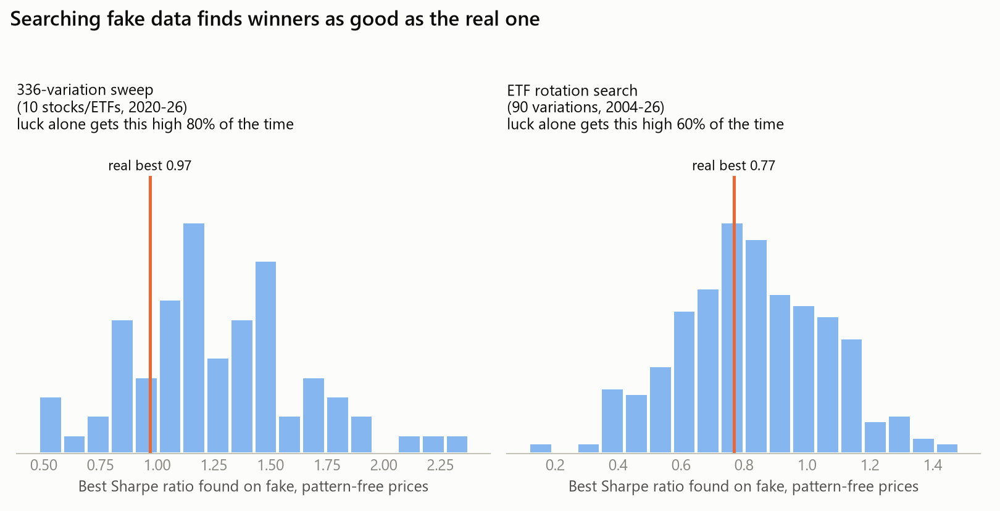

The orange line is the best score the search found on real prices. The bars show the best score the identical
search found on 300 (rotation) or 73 (sweep) fake price histories with no patterns. Real data did not beat chance.

### 3. Decades of data (Yahoo, 1993-2026, 10 tickers, includes 2000, 2008, 2020, 2022)

| Strategy | Beat buy-and-hold on Sharpe | Smaller max drawdown | Avg Sharpe (B&H 0.54) | Avg max drawdown (B&H -65%) |
|---|---|---|---|---|
| Vol target (10%) | 9 of 10 | 10 of 10 | 0.64 | -29% |
| Trend 200-day | 6 of 10 | 8 of 10 | 0.52 | -41% |
| SMA 20/50 | 2 of 10 | 10 of 10 | 0.44 | -42% |
| Walk-forward SMA | 2 of 10 | 10 of 10 | 0.45 | -43% |
| ML (logistic regression) | 0 of 10 | 10 of 10 | 0.29 | -33% |

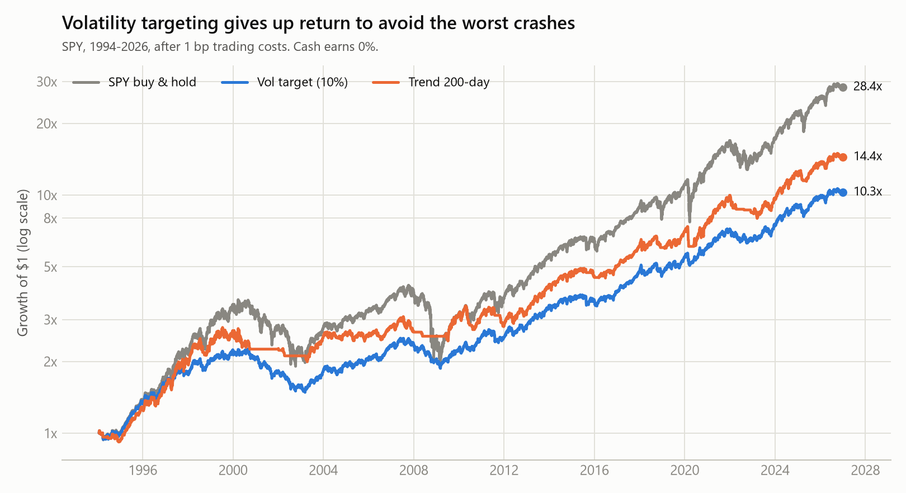

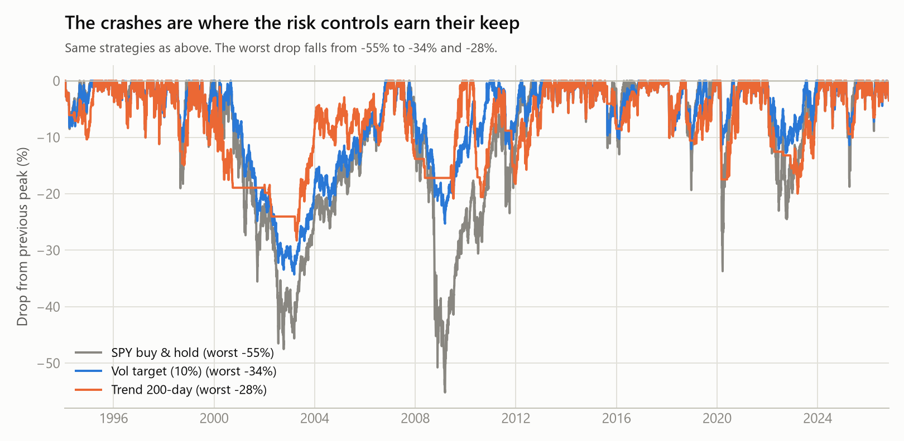

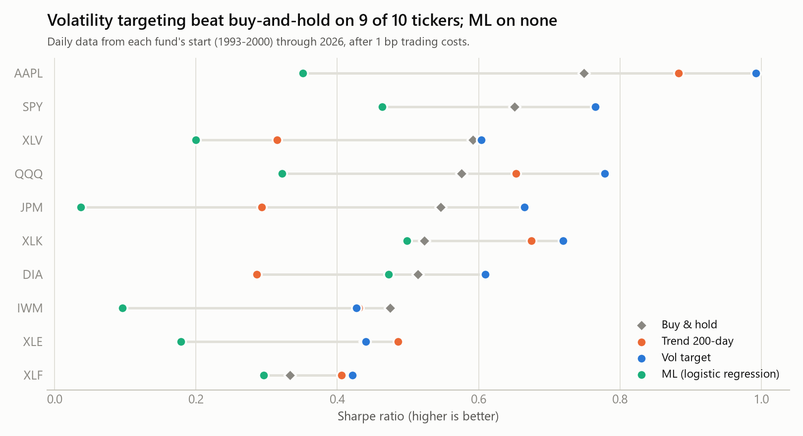

No strategy beat buy-and-hold on raw return except trend-following on AAPL (a survivor, so flattering).
Volatility targeting looked weak over five years and real over 27: a longer sample includes the crashes
where cutting exposure matters. This matches published research on volatility-managed portfolios.

### 4. ETF momentum rotation (23 ETFs, 2004-2026, 90 variations, 300 luck-test repetitions)

| | CAGR | Sharpe | Max drawdown |
|---|---|---|---|
| SPY buy-and-hold | 10.9% | 0.64 | -55% |
| 60/40 SPY/IEF | 8.4% | 0.79 | -31% |
| Rotation, 3-month, top 8 | 11.0% | 0.81 | -33% |
| Rotation, 3-month, top 8, dual momentum | 10.1% | 0.80 | -21% |

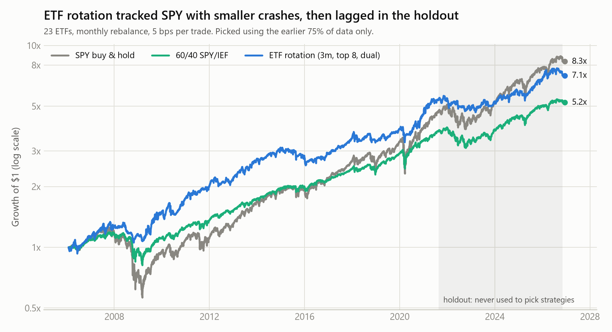

Over the full period rotation roughly matches SPY's return with a much smaller worst drop. But the finalists
**lost to buy-and-hold on the holdout** (Sharpe 0.54-0.61 vs 0.78), and the luck test gave p = 0.60 and
0.75. Most of the benefit came from 2008, inside the search window, so the full-period table flatters it.

### 5. Cross-market gap test (SPY vs IVV)
A recorder samples live bid/ask quotes once a second; the analyzer simulates trading each apparent gap
with realistic delay, crossing both spreads and paying fees. **Only a 5-minute sample (292 quotes) was captured**
(the laptop went to sleep mid-session), so treat this as a pilot, not a conclusion:

- SPY and IVV drifted apart by an average of 1.4 to 2.3 bps when a gap appeared (72 gaps over 1 bp, 7 over 2 bps).
- After spreads, **every simulated trade lost money, about -4.7 to -6.9 bps each, and 0% were profitable at any delay**,
  including zero latency.
- Reason: on the free IEX feed IVV's quoted spread was about 5 bps and SPY's about 1.3 bps, so crossing both costs
  more than the gap is worth. Median quote round-trip was 41 ms.
- Caveat: IEX shows only one exchange's quotes, which are wider than the whole market's, so this is somewhat
  pessimistic. A full-session recording is still needed to confirm.

### 6. Pooled-stock selection (154 large US stocks, 1993-2026, 334 out-of-sample months)
Each month-end, models rank stocks on eight features (momentum at several horizons, volatility, distance from the
52-week high, volume trend, beta). They are trained walk-forward (only on already-realized outcomes, retrained
yearly), hold the top fifth equal-weighted, pay 10 bps per trade, and are compared with an equal-weight basket of the
same stocks.

| | Return/yr | Sharpe | Beta vs basket |
|---|---|---|---|
| Equal-weight basket | 15.3% | 1.01 | 1.00 |
| Momentum alone | 17.1% | 0.97 | 0.87 |
| Ridge | 19.1% | 0.90 | 1.27 |
| Gradient boosting | 19.4% | 0.96 | 1.24 |

At first glance gradient boosting beats the basket by 4 points a year, and a naive luck test (random baskets) agreed
(p = 0.001). But the Sharpe ratios are all *lower* than the basket's, and the picks carry about 25% more market
risk, so most of the extra return is just extra market exposure. A random-basket test does not catch that.

The fair test hedges the market out: go long the picks and short (their beta x the basket), or train on
beta-adjusted returns instead. Ten variants were tried in total, so the bar was set high (alpha t-stat above ~3):

| Variant (hedged, net of costs) | Alpha/yr | Alpha t-stat | Rank-IC t-stat |
|---|---|---|---|
| Momentum alone | 0.1% | 0.0 | 0.0 |
| Ridge, beta-adjusted target | 2.2% | 1.4 | 4.1 |
| Gradient boosting, beta-adjusted target | 2.8% | 2.0 | 4.8 |
| Small neural net (32-16 units, 3-seed average), beta-adjusted target | 3.0% | 2.2 | 4.9 |
| Same three, without beta/volatility features | -0.3% to 1.9% | -0.2 to 1.5 | 2.4 to 3.2 |

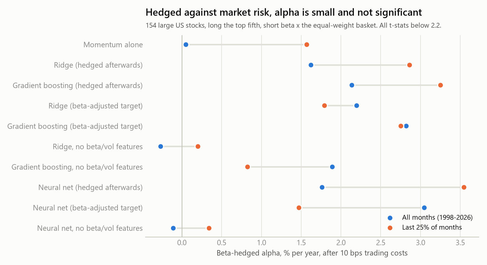

- **No variant clears the bar.** The best alpha t-stat is 2.2, and the models that cannot see beta or volatility
  have roughly zero alpha, so part of what looked like skill is a known low-risk tilt (low-beta stocks beating their
  beta-implied return), not stock-picking.
- **The neural net did no better than gradient boosting or ridge.** The additional model capacity added nothing.
  (This is scikit-learn's MLP; an LSTM or PyTorch model was not tried.)
- **The predictive signal decayed.** The rank correlation fell from 0.06-0.10 to about 0.01 in the last few years.

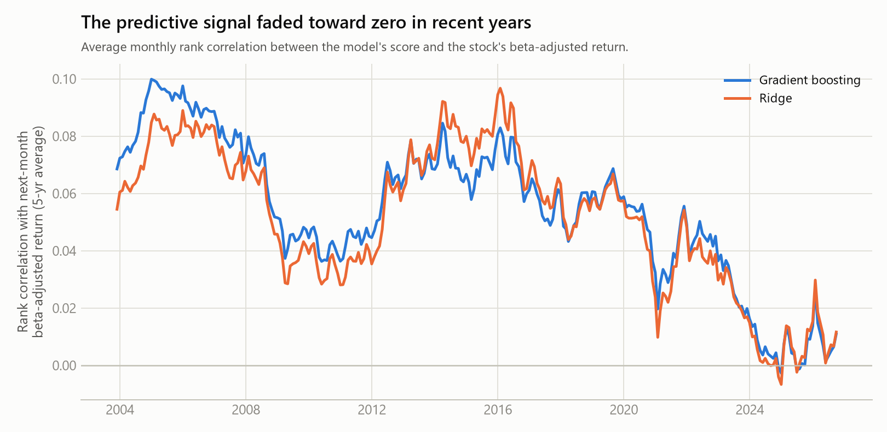

### 7. Risk control across asset classes, with cash interest and leverage (17 ETFs, 2004-2026)
The earlier backtests had two shortcuts: idle cash earned 0%, and volatility targeting never went above 100% invested.
This study fixes both (idle money earns the T-bill rate, borrowing pays T-bill + 0.5%/yr, 1 bp per trade) and asks
whether the effect holds beyond US stocks: 3 US stock ETFs, 3 international, 5 sectors, 4 bond funds, gold and REITs.
The 13 variants were fixed before running, so the luck-test bar was tightened to p < 0.004 (0.05 / 13), using the same
bootstrapped-history test as before. Sharpe is measured on returns above cash.

| Variant (vs buy-and-hold, average over 17 ETFs) | Sharpe change | ETFs with higher Sharpe | ETFs with smaller worst drop | Return/yr change | Luck-test p |
|---|---|---|---|---|---|
| Vol target 10%, no leverage | +0.03 | 10 of 17 | 94% | -2.1 pts | 0.35 |
| Vol target 10%, up to 1.5x | +0.02 | 9 of 17 | 82% | -2.0 pts | 0.35 |
| Vol target 15%, no leverage | +0.03 | 9 of 17 | 88% | -0.9 pts | 0.32 |
| Vol target 15%, up to 1.5x | +0.02 | 8 of 17 | 71% | -0.6 pts | 0.36 |
| 200-day trend | -0.04 | 6 of 17 | 100% | -2.2 pts | 0.03 |
| Vol target 10% + trend | -0.05 | 6 of 17 | 100% | -3.4 pts | 0.17 |

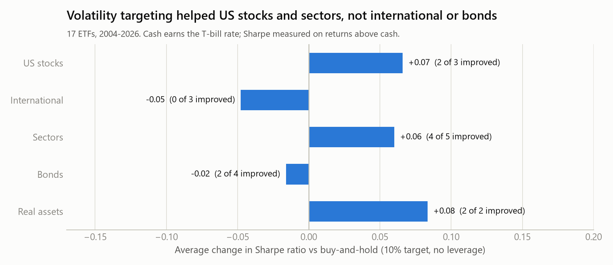

- **Cutting the worst drop is reliable; improving Sharpe is not.** Volatility targeting shrank the worst drop on 71-94%
  of the ETFs, but raised Sharpe on about half of them, no better than a coin flip. The luck test agrees: the real
  Sharpe gain (+0.03) is not distinguishable from what bootstrapped history produces (p about 0.35). No variant passes p < 0.004.
- **It helps where equity risk clusters** (US stocks +0.07, sectors +0.06, gold and REITs +0.08) and **not elsewhere**
  (international stocks -0.05 with 0 of 3 improved, bonds -0.02). So it is not a universal law, and the earlier SPY-only
  result should be read as mostly a US-equity result.
- **Leverage did not fix the return give-up.** Allowing 1.3x-1.5x with a financing cost left the Sharpe change unchanged,
  and the "same return, lower risk" outcome was rare (0% of ETFs at a 10% target, 12-29% at a 15% target).
- **Diversification was the most promising piece.** Weighting SPY, EFA, TLT, GLD and VNQ by inverse volatility:

| All months (2005-2026) | Sharpe | Return/yr | Volatility | Worst drop |
|---|---|---|---|---|
| SPY buy-and-hold | 0.56 | 11.1% | 19.1% | -55% |
| 60/40 SPY/IEF | 0.64 | 8.5% | 11.0% | -31% |
| Equal-weight 5 assets | 0.56 | 8.7% | 13.3% | -36% |
| Risk parity | 0.70 | 9.1% | 10.8% | -25% |
| Risk parity, 10% vol, up to 1.5x | 0.69 | 8.7% | 10.3% | -20% |

  Risk parity beats equal-weight on Sharpe (luck-test p = 0.016, better than the single-asset variants but still above the
  0.004 bar) and roughly halves the worst drop. But in the last 25% of months its Sharpe was 0.32 against SPY's 0.57:
  likely because of the 2022 stock-and-bond selloff and a long US stock rally (the cause was not tested).

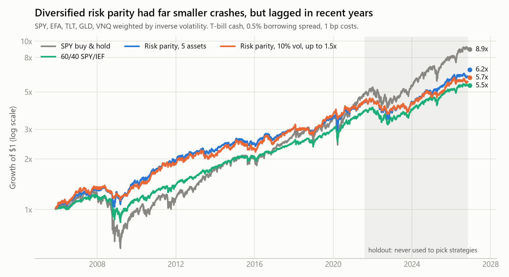

### 8. Does better volatility forecasting improve volatility targeting? (17 ETFs, 2004-2026)
Volatility is the one market quantity that is genuinely predictable, and volatility targeting depends on forecasting it,
so this was the most natural place to try more sophisticated models. Nine forecasters, fixed in advance, were compared
with the simple 20-day estimate the strategy uses. Each predicts the average squared return over the next 5 days and is
walk-forward (a forecast at date *t* only uses data through *t* and only trains on outcomes already realized). A test
confirms the HAR, gradient-boosting and GARCH forecasts do not change when future prices are altered. Forecast error is
measured with QLIKE, the standard loss for variance forecasts. Then each forecast drives the strategy (10% target, no
leverage, T-bill cash, 1 bp costs) and the Sharpe change versus the 20-day rule is tested with a block bootstrap
(9 comparisons, so the bar is p < 0.0055).

| Forecaster | Forecast error vs 20-day rule | ETFs better (of 17) | Strategy Sharpe change | Bootstrap p |
|---|---|---|---|---|
| 60-day average | 2% worse | 4 | -0.013 | 0.72 |
| EWMA (RiskMetrics) | 12% better | 17 | -0.002 | 0.59 |
| GARCH(1,1) | 16% better | 17 | +0.004 | 0.41 |
| HAR regression | 13% better | 17 | -0.008 | 0.73 |
| HAR + VIX | **21% better** | 17 | -0.022 | 0.90 |
| Gradient boosting | 15% better | 17 | -0.035 | 0.98 |
| Gradient boosting + VIX | 15% better | 17 | -0.030 | 0.93 |
| Neural net | 19% better | 17 | -0.031 | 0.96 |
| Neural net + VIX | 18% better | 17 | -0.036 | 0.94 |

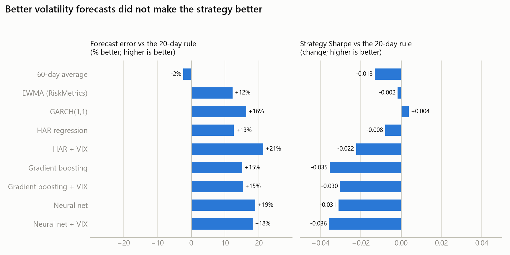

- **Volatility really is more predictable than the 20-day rule captures.** Eight of nine forecasters were 12-21% more
  accurate on every ETF (significantly so on 12-17 of 17), and they held up in the last 25% of months.
- **The neural net had no edge over classical models.** The best forecaster was a four-variable regression with VIX.
- **But none of it helped the strategy.** Sharpe changes ranged from -0.04 to +0.00, none significant, and the worst drop
  did not improve. The most accurate forecasters were not the best for trading.
- **Possible reasons (not tested):** better models expect volatility spikes to fade and so keep more exposure during
  turbulence, and bias-corrected forecasts lower average exposure (return fell from 5.3% to about 4.7% a year).
  Accuracy on typical days matters less for sizing than getting the few crisis days right.

The forward test keeps the simple 20-day rule.

### 9. Minervini-style trend template (154 stocks, 1994-2026, 5 variants, 200-repetition luck test)
Rules (all from daily closes): close above the 150- and 200-day averages, 150 above 200, 200-day rising, 50 above 150,
close above the 50-day, 30% above the 52-week low and within 25% of the high, 12-1 month momentum in the top 30%, then a
breakout above the prior 50-day high on 1.4x volume. Exit on an 8% stop or a close below the 50-day (or a 20% trailing
stop). Fills are one bar after the signal, 10 bps per side, idle cash earns the T-bill rate, positions are 12.5% of
equity (8 max; 6.7% x 15 in one variant). Five variants were fixed in advance, so the luck-test bar is p < 0.01.

| Full period | CAGR | Sharpe | Max drawdown |
|---|---|---|---|
| SPY buy-and-hold | 10.7% | 0.51 | -55% |
| Equal-weight basket of the same 154 stocks | 17.9% | 0.86 | -49% |
| Template + breakout, no market filter | 11.0% | 0.54 | -62% |
| Template + breakout, SPY 200-day filter | 13.2% | 0.71 | -24% |
| Template held (no breakout), SPY filter | 16.6% | 0.72 | -37% |
| 15 positions, SPY filter | 10.3% | 0.63 | -19% |

- **The market filter did the work, not the stock picking.** It took the worst drop from -62% to -24%. Dropping the
  breakout entry (just hold any template stock) did best, so the breakout trigger added nothing.
- **It did not hold up out of sample.** In the last 25% every variant had a lower Sharpe (0.22-0.45) than SPY (0.66),
  and the alpha vs SPY was -0.8% to +3.9% a year with t-stats of -0.2 to 0.6.
- **Luck test (balanced panel of 143 stocks, 2000-2026): not distinguishable from luck.** The best real Sharpe, 0.578,
  sits at the median of what the best-of-five variants scores on bootstrapped prices (0.541, p = 0.445 against a bar of 0.01).
- **It also lost to a filtered plain basket.** The equal-weight basket held only while SPY is above its 200-day scored
  Sharpe 0.87 and a -21% worst drop. Regressing each variant on it gave alpha t-stats of at most 1.3 and about zero
  in the holdout, so the stock picking adds nothing beyond the filter.
- **That filtered-basket result is survivorship bias.** On RSP, a real equal-weight S&P 500 fund that includes the
  companies that later dropped out (2004-2026):

| | CAGR | Sharpe | Max drawdown |
|---|---|---|---|
| SPY | 10.9% | 0.55 | -55% |
| RSP | 10.3% | 0.50 | -60% |
| RSP with 200-day filter | 5.8% | 0.38 | -27% |
| Survivor basket (our 154 stocks) | 15.2% | 0.76 | -49% |
| Survivor basket with filter | 10.2% | 0.75 | -21% |

  Our 154 stocks beat RSP by about 5 points a year purely through hindsight. The filter on a real fund halved the
  return, cut Sharpe, and in the last 25% of months scored a Sharpe of 0.05 against RSP's 0.48.
- **Stacking the safeguards did not help either.** In section 7's saved results, adding a per-asset trend filter to
  the volatility-targeted risk-parity portfolio lowered Sharpe from 0.69 to 0.60 and CAGR from 8.7% to 7.0%.
- Not modelled: intraday stops (a stop triggers on the close and fills the next close), tight-base pattern
  recognition, and fundamentals.

### 10. Regime switching on top of buy and hold (7 index funds, 1993-2026)
The question: can we tell calm "bull" markets from stressed ones, and does stepping aside during stress beat simply
holding? A 2-state Markov-switching model (a calm state and a high-variance stress state, each with its own mean and
variance) was refit on past data every 63 days. Between refits the daily probability of stress is filtered forward with
fixed parameters, so each day only uses data up to that day (a test confirms the probabilities do not change when
future prices change). The funds were SPY, QQQ, IWM, DIA, EFA, EEM and EWJ, each with 27-33 years of history
covering 1998-2003, 2008 and 2020. Three variants were fixed in advance, so the luck-test bar is p < 0.017: hold only
while P(stress) < 0.5 (hard), hold a fraction 1 - P(stress) (soft), and hard plus the 200-day trend rule. The luck test
circularly shifts each position series by a random amount, which keeps the exposure and the switching pattern but
breaks the link to returns, and asks how often random timing matches the real Sharpe.

| Average over 7 funds | Sharpe change vs buy-and-hold | Funds improved (of 7) | Return/yr | Worst drop | Last 25%: Sharpe change |
|---|---|---|---|---|---|
| Buy and hold | 0 | | 8.3% | -59% | 0 |
| 200-day trend | -0.04 | 3 | 6.0% | -35% | +0.02 |
| Regime model, hard | -0.02 | 3 | 6.4% | -45% | -0.15 |
| Regime model, soft | +0.00 | 4 | 6.5% | -40% | -0.08 |
| Regime model, hard + trend | -0.07 | 2 | 5.2% | -32% | -0.15 |

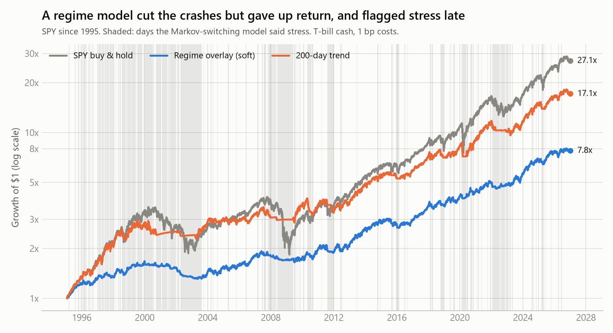

- **It cut the crashes but earned no extra Sharpe.** The soft version matched buy-and-hold on Sharpe (+0.00) with a worst
  drop of -40% instead of -59%, at a cost of about 2 points of return a year. That is risk reduction, the same trade
  volatility targeting makes: the "stress" state is essentially a high-volatility state.
- **None beat random timing.** The median luck-test p-value was 0.16-0.28; the best single result was QQQ with the hard
  variant at p = 0.039, above the 0.017 bar. In the last 25% of days the regime variants lost to buy-and-hold (Sharpe
  change -0.08 to -0.15) while the plain 200-day rule edged ahead (+0.02).
- **The flag comes late.** SPY had 12 drawdowns of 10% or more since 1997. In 9 the model flagged stress after the peak,
  and by then a median of 25% of the eventual fall had already happened (range 8-53%). In 3 episodes it was already
  flagging stress before the peak, because the 1997 and 1998-2000 rallies were high-volatility, not low.
- **How long regimes last is barely predictable.** There were 396 stress periods of 5+ days across the 7 funds; the median
  lasted 11 days and the longest 276. The model's expected duration at the start had a Spearman correlation of only 0.23
  with the realized length. SPY's big drawdowns took anywhere from 9 to 637 trading days to bottom and from 42 to 1,657
  to recover, with nothing at the start to say which kind it would be.

### 11. Other eras, countries and asset types (19 markets, up to 65 years)
Most earlier evidence came from US markets over 20-30 years, so the frozen forward-test rule (10% target volatility,
20-day estimate, never above 100% invested) was tested on markets chosen in advance: the S&P 500 price index back to 1960
(split into four eras), nine foreign stock indexes (Japan, UK, Germany, France, Hong Kong, Australia, Canada, Brazil,
South Korea) and nine other assets (gold, silver, broad commodities, oil, US dollar, euro, yen, Bitcoin, Ether; crypto is
annualized over 365 days). The 200-day trend rule was run alongside as a comparison. Cash earns the US T-bill rate, trades cost
1 bp, and stock indexes are price indexes, which understates returns but compares strategy and buy-and-hold fairly. Each market
gets a paired-bootstrap 95% interval for the Sharpe change and a pattern-free bootstrap p-value. Support for volatility
targeting was defined in advance as: at least two thirds of all markets improve **and** the cross-market interval for the
average Sharpe change excludes zero.

| | Markets with higher Sharpe | Average Sharpe change | Cross-market 95% interval | Avg worst drop (buy-and-hold -63%) | Last 25% of days: markets improved |
|---|---|---|---|---|---|
| Volatility targeting (frozen rule) | 7 of 19 (37%) | -0.022 | -0.047 to +0.001 | -37% | 5 of 19 |
| 200-day trend rule | 15 of 19 (79%) | +0.077 | +0.028 to +0.123 | -38% | 6 of 19 |

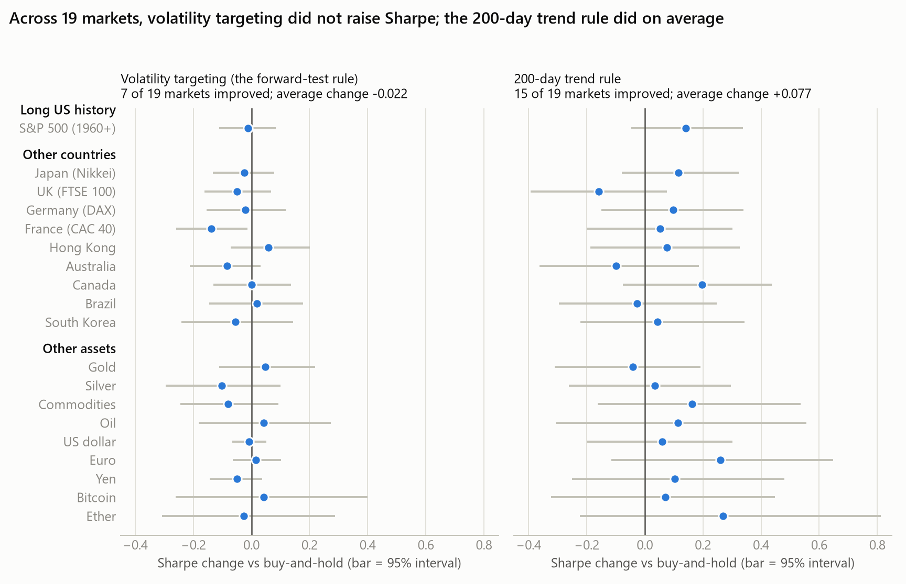

| S&P 500 by era | Buy-and-hold Sharpe | Vol-target change | Trend change | Worst drop: buy-and-hold / vol-target / trend |
|---|---|---|---|---|
| 1962-79 | -0.20 | -0.05 | +0.37 | -48% / -31% / -14% |
| 1980-99 | 0.47 | -0.01 | +0.11 | -34% / -19% / -15% |
| 2000-09 | -0.13 | -0.13 | +0.08 | -57% / -34% / -20% |
| 2010-26 | 0.66 | +0.03 | -0.13 | -34% / -13% / -19% |

- **The frozen rule is not supported.** It raised Sharpe in 7 of 19 markets, below the two-thirds bar, and the average change
  was slightly negative. Only Hong Kong beat the pattern-free test at p < 0.05 (one of 19 is what chance alone gives).
  No era of the S&P 500 clearly favored it either; it helped only in 2010-26 (+0.03) and hurt in 2000-09 (-0.13).
- **It reliably cuts the worst drop, in almost every market.** The worst drop shrank in 18 of 19 markets (Nikkei -82% to -53%,
  S&P 500 -57% to -34%, Bitcoin -83% to -21%). The price is return: Bitcoin's yearly return fell by about 49 points because
  a 10% volatility target keeps it mostly in cash.
- **The simple 200-day trend rule did better, on average.** It improved Sharpe in 15 of 19 markets, its interval excludes
  zero, and on the S&P 500 since 1960 it earned Sharpe 0.41 vs 0.27 with a -23% worst drop instead of -57%. Five markets
  passed p < 0.05 (about one expected by chance).
- **But the trend rule's edge is old, and the evidence is thinner than it looks.** It was strongest in 1962-79 and slightly
  negative in 2010-26, and in the last 25% of days it improved only 6 of 19 markets. This was a secondary comparison, and
  the 19 markets are highly correlated (the global stock indexes especially), so they are fewer independent tests than 19.
  In the earlier 17-ETF study (2004-26) the same trend rule had a Sharpe change of -0.04.
- **Switching markets did not rescue volatility targeting.** The forecasting works everywhere, but the benefit to returns
  per unit of risk was not found in other countries, eras or asset types; the dependable effect is a smaller worst drop.

### 12. Individual big stocks vs an index fund (154 large US stocks, 1993-2026)
How would owning individual big companies compare with SPY (dividends included)? Three parts, fixed in advance.
Parts 1 and 2 use today's large caps, which are survivors, so **their win rates are upper bounds** and flatter stock picking.
Part 3 avoids hindsight by taking the 10 largest US companies at past dates (approximate lists written from memory, not an
official ranking) and holding them equal-weight. A company with no price history left (Lucent, 1999) is bounded: best case it
matches SPY, worst case it goes to zero. Windows overlap heavily, so read the numbers as a pattern, not precise odds.

**Part 1: one stock vs SPY over the next N years, every month-end start (survivors only)**

| Horizon | Stock beat SPY | Median stock vs SPY | 10th to 90th percentile | Ended below its start | Ended with under half of SPY's growth |
|---|---|---|---|---|---|
| 1 year | 53% | 1.01x | 0.75x to 1.37x | 29% | 1% |
| 3 years | 55% | 1.05x | 0.63x to 1.77x | 19% | 5% |
| 5 years | 57% | 1.09x | 0.57x to 2.17x | 14% | 7% |
| 10 years | 63% | 1.24x | 0.52x to 3.16x | 7% | 9% |
| 20 years | 69% | 1.50x | 0.49x to 5.34x | 3% | 10% |

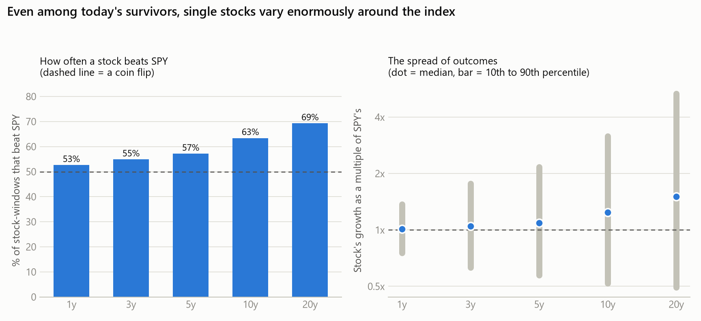

**Part 2: random equal-weight baskets of those stocks over 10 years (500 random baskets per start month)**

| Stocks held | Beat SPY | Median vs SPY | 10th percentile vs SPY | Trailed SPY by 30%+ |
|---|---|---|---|---|
| 1 | 64% | 1.25x | 0.53x | 18% |
| 3 | 78% | 1.44x | 0.79x | 6% |
| 5 | 84% | 1.50x | 0.89x | 3% |
| 10 | 90% | 1.58x | 1.00x | 1% |
| 20 | 94% | 1.67x | 1.10x | 0.3% |
| 30 | 96% | 1.72x | 1.15x | 0.1% |

**Part 3: the 10 largest US companies at each date, held 10 years (no hindsight)**

| Biggest at end of | SPY | The 10 biggest (worst to best case) | Stocks beating SPY | Best / worst stock |
|---|---|---|---|---|
| 1999 | 0.94x | 0.74x to 0.84x | 2 of 9 | Exxon / Citigroup |
| 2004 | 2.06x | 1.42x | 4 of 10 | Exxon / AIG |
| 2009 | 3.50x | 3.82x | 3 of 10 | Apple / GE |
| 2014 | 3.42x | 4.20x | 4 of 10 | Microsoft / GE |

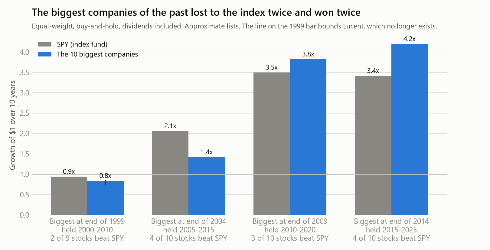

- **Parts 1 and 2 look good for stocks, and are mostly survivorship.** A random basket of 20 survivors beat SPY 94% of the
  time, which no one could have known in advance: it reflects picking companies that, by today, are known to have won, plus
  an equal-weight tilt away from the handful of mega-caps that dominate the index.
- **Without hindsight it is closer to a coin flip.** The 10 biggest companies beat SPY in 3 of 8 windows (4 dates, held 5 and
  10 years). The 1999 and 2004 groups lost badly (the 2004 group's AIG and Citigroup were hit by the financial crisis); the 2009
  and 2014 groups won, carried by Apple and Microsoft. In each decade only 2 to 4 of the 10 beat SPY individually.
- **Concentration is the real risk.** Among survivors, one stock had an 18% chance of trailing SPY by 30% or more over ten
  years, against 0.1% for a basket of 30. Even among survivors, one stock in eleven ended with less than half of SPY's growth
  over 10 years; for the real population including failures it would be higher.
- **What it does and does not show.** It gives no evidence that picking big individual stocks reliably beats an index fund,
  and a clear picture of wider outcomes. It cannot rule out that a skilled stock picker exists. The lists in part 3 are
  approximate; with a point-in-time constituent database (see "Not tested") this could be done exactly.

### 13. What the US government has invested in (reported equity stakes, 2025-2026)
Since mid-2025 the US government has taken direct equity stakes, warrants or "golden shares" in a growing list of companies,
mostly in chips, critical minerals, defense, nuclear and quantum computing. `python main.py govstakes` holds a sourced
per-deal list and checks how the listed stocks have done since each announcement. **It is a research list compiled by hand from
public reporting, not an official register**: CNBC (7 Feb 2026), a US News/WTOP piece (21 Jun 2026, citing the Council on Foreign
Relations deal tracker), a newsletter (31 May 2026) and a Trilogy Metals SEC release (11 Sep 2026). The sources disagree on the
total (at least 10, 17 or 26 deals) and on some dates and terms, so every row carries a confidence level and the sources behind
it, and deals announced after the newest source are not covered.

- **21 deals tracked, 11 in listed companies.** Examples: Intel (about 10%, 433.3M shares at $20.47), MP Materials (about 15% if
  the preferred converts), Lithium Americas (5%), Trilogy Metals (about 10%, closed in September 2026), USA Rare Earth (letter
  of intent), plus golden-share, private-company and quantum-computing deals.
- **Only 1 of 9 listed stocks with a known announcement date beat the S&P 500 since then** (close on announcement day to 16 Nov 2026,
  dividends included, SPY over the same dates):

| Stock | Announced | Since announcement | S&P 500, same dates |
|---|---|---|---|
| Intel (INTC) | 22 Aug 2025 | +124% | +16% |
| IBM | 21 May 2026 | -3% | +0% |
| MP Materials (MP) | 10 Jul 2025 | -20% | +20% |
| L3Harris (LHX) | 13 Jan 2026 | -22% | +8% |
| Infleqtion (INFQ) | 21 May 2026 | -46% | +0% |
| GlobalFoundries (GFS) | 21 May 2026 | -51% | +0% |
| Rigetti (RGTI) | 21 May 2026 | -59% | +0% |
| D-Wave (QBTS) | 21 May 2026 | -66% | +0% |
| USA Rare Earth (USAR) | 26 Jan 2026 | -73% | +8% |

- **The Intel stake is worth about $24.0B at $55.47, against about $8.9B paid** (share count only, warrants ignored). Intel closed
  near $141 in June and has fallen sharply since, including a 28.6% drop after its 30 Oct earnings report, which I confirmed
  against a second news source. The June figures in the articles match the price data used here.
- **Read it carefully.** Several deals are only letters of intent or proposals, announcement dates for Lithium Americas and Trilogy
  Metals are not given in the sources (so they are left out of the comparison), the quantum names are a single announcement date, and
  stakes agreed by a government are not stock picks. This is a snapshot of nine stocks over different windows, not evidence about
  what happens to stocks the government buys.
- **Congress trades are not included.** The two free community feeds that republished House and Senate trade disclosures now
  refuse access, and the official filings are scanned documents on government portals, so there is nothing reliable to chart
  without a paid data feed. A panel filled with guesses would be worse than none.
- A private web dashboard (a data page with the stakes table, the growth chart and the sources) is built from the same files; it
  is not part of this repository.

**Why the government did it (as reported)**

The purposes below are the ones described in the news reports and filings used for this list, not a judgment on whether the deals will work.

- **Chips and quantum computing:** Commerce Department money from the CHIPS Act, now taken partly as shares. For Intel, grants that had not been paid out were converted into 433.3M shares.
- **Critical minerals and rare earths:** building a domestic supply chain for magnets, lithium and metals used in defense and electronics. MP Materials' deal also set a price floor and a purchase agreement.
- **Defense:** $1B toward rocket motors for missiles, converting into shares if that unit goes public.
- **Nuclear power:** financing for new reactors in return for a participation interest in Westinghouse.
- **Jobs and plants:** at U.S. Steel a golden share lets the government veto closing plants or moving headquarters, with no economic stake.
- **Protecting taxpayers:** Lithium Americas' stake is described as a cash buffer against taxpayer risk on a federal loan.

Commentators have questioned whether this is a good precedent, and one news summary mentioned a pending lawsuit over the Intel stake (not verified here).

**All 21 reported deals**

| Company | Agency | Status | Purpose | Confidence |
|---|---|---|---|---|
| Intel (INTC) | Commerce Dept (reports differ) | Agreed | Chipmaking; converted CHIPS Act grants | High |
| MP Materials (MP) | Defense Dept | Agreed | Rare earth magnets and supply | High |
| Lithium Americas (LAC) | Energy Dept | Agreed | Lithium mine in Nevada | High |
| Trilogy Metals (TMQ) | Dept of War per SEC release (news said White House) | Closed | Alaska copper-zinc project and Ambler Road | High |
| USA Rare Earth (USAR) | Commerce Dept | Letter of intent | Rare earth magnets, Oklahoma and Texas | Medium |
| L3Harris (missile unit) (LHX) | Pentagon | Announced | Missile and rocket motors | Medium |
| Westinghouse | Commerce Dept | Agreed (conditional) | Financing for nuclear plants (owned by Cameco and Brookfield) | Medium |
| Vulcan Elements | Commerce (equity) and Pentagon (warrants, loan) | Agreed | Rare earth magnet supply chain | Medium |
| xLight | Commerce Dept | Letter of intent | Lasers for chip manufacturing | Medium |
| U.S. Steel | Federal government | Agreed | Conditions on the Nippon Steel acquisition; stock no longer trades | High |
| IBM (quantum foundry unit) (IBM) | Commerce Dept | Letter of intent | Quantum chip manufacturing | Medium |
| GlobalFoundries (GFS) | Commerce Dept | Letter of intent | Chip manufacturing | Low |
| D-Wave Quantum (QBTS) | Commerce Dept | Letter of intent | Quantum computing | Low |
| Rigetti Computing (RGTI) | Commerce Dept | Letter of intent | Quantum computing | Low |
| Infleqtion (INFQ) | Commerce Dept | Letter of intent | Quantum computing | Low |
| Atom Computing | Commerce Dept | Letter of intent | Quantum computing | Low |
| PsiQuantum | Commerce Dept | Letter of intent | Quantum computing | Low |
| Quantinuum | Commerce Dept | Letter of intent | Quantum computing | Low |
| Diraq | Commerce Dept | Letter of intent | Quantum computing | Low |
| ReElement Technologies | Not stated | Reported | Rare earth processing | Low |
| Korea Zinc | Not stated | Reported | Metals | Low |

Confidence: High means a filing or several outlets agree, Medium means one or two outlets or conditional terms, Low means a single secondary source. Instruments, amounts, dates and sources for each deal are in `aitrader/govstakes.py`.

## Conclusions

1. **Beating buy-and-hold on return is not supported by the evidence here**, for any approach tested.
2. **Risk control lowers the worst drawdown, but its Sharpe benefit is modest and not proven.** Volatility
   targeting, trend filters and diversification cut crashes by roughly half, which is risk management, not extra profit.
   Across 17 ETFs the Sharpe gain was concentrated in US equities and sectors, failed on international stocks and
   bonds, and did not clear a strict luck test. Diversification across stocks, bonds and gold was the most promising
   version, but it lagged in the most recent years.
3. **Machine learning did not help, at any scale.** On single-ticker daily data it did worst. Pooling 154 stocks
   (about 50,000 stock-months) and moving from ridge to gradient boosting to a small neural net produced no
   significant alpha once market exposure was hedged out, and the signal faded in recent years.
   Models that picked riskier stocks looked impressive until the beta hedge exposed them.
4. **Textbook stock-picking rules (Minervini's trend template) did not beat chance either.** Their Sharpe sat at the median
   of the bootstrapped null (p = 0.445), they lost to a plain filtered basket, and the "filtered basket" that looked
   good was survivorship bias (a real equal-weight fund with the same filter earned half the return).
5. **Searching many variations produces impressive-looking winners by chance.** On fake data the best of
   336 variations regularly scored higher than the best on real data. Without a luck test this would have
   gone unnoticed.
6. **Predictable is not the same as profitable.** Volatility forecasts from GARCH, HAR and neural nets were 12-21%
   more accurate than the simple 20-day rule, yet using them did not improve the strategy's Sharpe. The simple rule
   is good enough, and the project's one working idea does not need machine learning.
7. **Predicting market regimes and combining that with buy and hold did not help.** A Markov-switching model cut the
   worst drop from -59% to -40% but matched buy-and-hold on Sharpe at best, lost to buy-and-hold in the last 25% of
   days, failed a random-timing test, flagged stress after a quarter of the fall on average, and could not predict
   how long a stress period would last (rank correlation 0.23).
8. **Other markets and eras did not change the picture.** Across 19 markets (the S&P 500 since 1960, nine foreign stock
   indexes, nine other assets) the frozen volatility-targeting rule improved Sharpe in only 7 and cut the worst drop in 18.
   The 200-day trend rule did better on average (15 of 19 markets), but its edge was concentrated before 2010 and faded in
   the most recent data, so it is running as a second forward-test track (IVV, the same S&P 500 index, so the two
   tracks hold separate positions) rather than being treated as a proven improvement.
9. **Big individual stocks did not reliably beat an index fund.** Among today's survivors a single stock beat SPY 63% of
   the time over 10 years and random 20-stock baskets 94%, but that is hindsight. Taking the 10 largest companies at past
   dates, the group beat SPY in only 3 of 8 windows, only 2 to 4 of the 10 beat it individually, and one stock had an 18%
   chance of trailing the index by 30% or more. The clearest effect of owning individual stocks is wider outcomes.

## Limitations

- Free data: Alpaca's IEX feed covers only about 5 years; Yahoo is unofficial.
- Single stocks (e.g. AAPL, JPM) carry **survivorship bias**: they were picked knowing they survived. ETF
  and index results are much cleaner. A real fix needs point-in-time constituent data (Norgate, Sharadar, CRSP).
- Cash earns 0% in the earlier backtests (the risk-control study uses T-bill rates); leverage and taxes are ignored; rotation assumes constant daily weights
  between month-end rebalances.
- The 10 tickers are highly correlated, so they provide less independent evidence than ten would suggest.
- The test period is dominated by one long bull market.

## Not tested

- **Intraday / day trading** (gap-and-go, momentum scalping, discretionary tape reading). Everything above uses daily
  bars. Testing it honestly needs paid intraday data, and the discretionary parts cannot be fully coded.
- **Clean single-stock selection.** Stock-level results (sections 6 and 9) use today's large caps; point-in-time
  constituent data would be needed to remove the survivorship bias.
- **Live results.** Only the frozen forward tests (`python main.py forward`, two tracks, Alpaca paper money) can show whether any
  of this survives outside a backtest; it needs months to say anything.

## Setup and usage (Windows)

```bash
pip install -r requirements.txt yfinance
copy .env.example .env      # add your Alpaca PAPER keys; .env is git-ignored
python -m pytest
```

```bash
python main.py backtest --symbol SPY --start 2018-01-01 --strategy sma     # also: ml, trend, vol
python main.py walkforward --symbol SPY --start 2018-01-01
python main.py compare --source yahoo --start 1993-01-01                    # all strategies x 10 tickers
python main.py sweep --max-hours 7                                          # 336 variations + luck test (long)
python main.py sweep-report                                                 # summarize saved sweep results
python main.py rotation --reps 300                                          # ETF rotation + luck test
python main.py paper --symbol SPY --strategy sma --dry-run                  # Alpaca paper account
python main.py gaps-session --symbols SPY IVV --days 1                      # record quotes during market hours
python main.py gaps-analyze --csv data/quotes_SPY_IVV.csv
```

```bash
python main.py crosssec --refresh                    # download 154 stocks; momentum / ridge / gradient boosting vs equal-weight
python main.py crosssec --neutral                    # beta-hedged check (7 variants + luck test)
python main.py crosssec --neutral --mlp --reps 500   # small neural-net variants
python main.py regime                                # Markov-switching regime overlay on 7 index funds (~10 min)
python main.py globalstudy                           # frozen vol rule + trend rule across 19 markets and eras (~10 min)
python main.py stockstudy                            # individual big stocks vs SPY (needs the stocks cached by crosssec --refresh)
python main.py govstakes                             # US government equity stakes: sourced list + performance since announcement
```

```bash
python main.py minervini --reps 200                  # trend-template stock portfolio vs buy-and-hold + luck test (~20 min)
python main.py minervini --baseline                  # same variants vs the SPY-200-day-filtered basket
python main.py minervini --rsp                       # survivorship check: the filter on RSP, a real equal-weight fund
python main.py riskstudy --reps 500                  # risk control across 17 ETFs, with T-bill cash and leverage
python main.py volforecast --reps 500                # volatility forecasters: accuracy and strategy impact
python main.py forward                               # both frozen tracks after the close: vol target (SPY) + 200-day trend (IVV), Alpaca paper
python main.py forward --track trend --dry-run       # one track, decision logged but no order
python main.py forward-report                        # each track vs buy and hold
```

`python make_charts.py` regenerates the charts in `docs/` from the saved study results.

Add `--synthetic` to `backtest` / `walkforward` to run offline on generated data.
